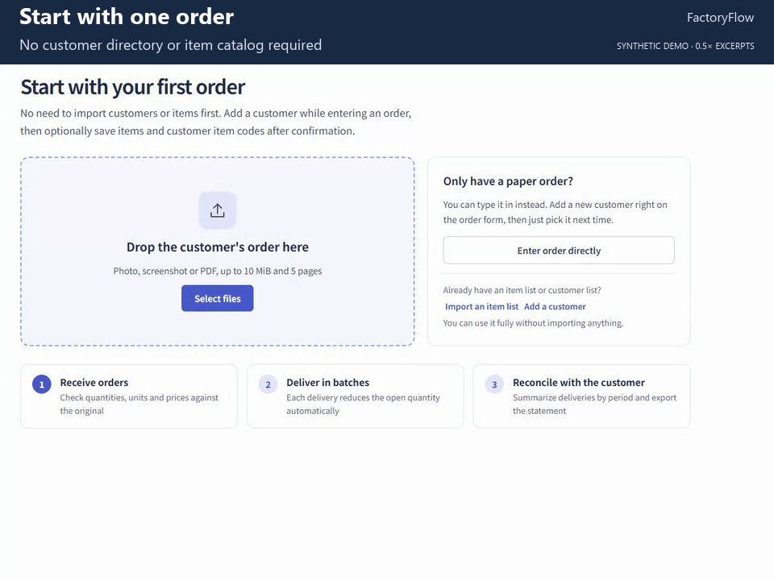
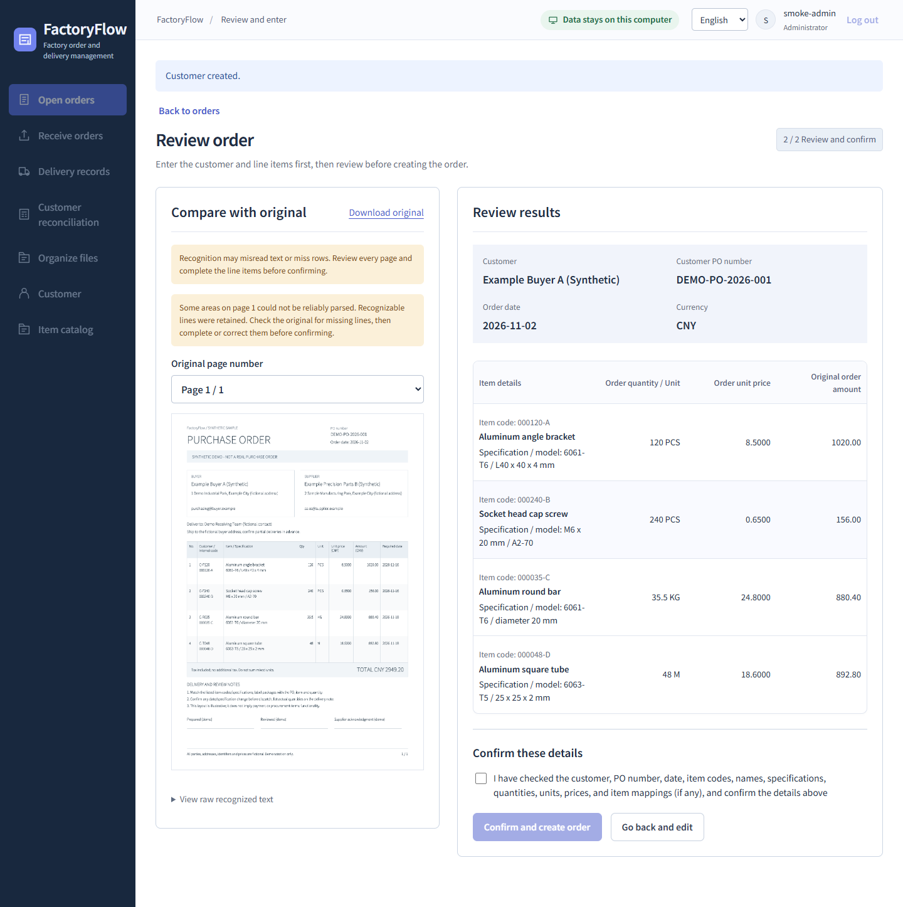
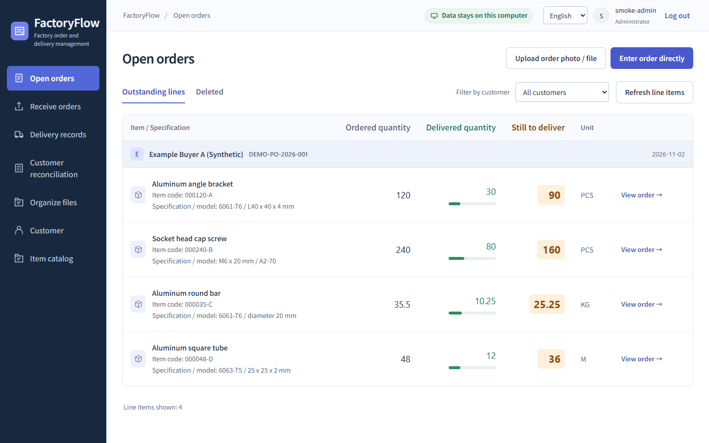

<p align="center"><a href="README.md">简体中文</a> · <strong>English</strong></p>

<p align="center">
  
</p>

<h1 align="center">FactoryFlow</h1>

<p align="center">
  <strong>Orders, deliveries and customer statements for small manufacturers.</strong><br>
  Built with direct involvement from frontline factory staff. An earlier version is in daily factory use.<br>
  Start with your first order, no setup imports. Core workflows and OCR run on your own computer by default.
</p>

<p align="center">
  <a href="https://github.com/Doublzzz/FactoryFlow/releases/tag/v0.1.0-preview.3"></a>
  
  
  <a href="https://github.com/Doublzzz/FactoryFlow/actions/workflows/verify.yml"></a>
  <a href="LICENSE"></a>
</p>

<p align="center">
  <a href="#download-and-try">Download</a> · <a href="#how-an-order-moves">How it works</a> · <a href="#custom-features-and-new-modules">Custom features</a>
</p>



<p align="center"><sub>Synthetic demo, 0.5× excerpts. Item rows were entered manually after OCR; waiting and some edits are omitted. <a href="docs/README-SCREENSHOTS.md#english-first-order-gif">Capture notes</a></sub></p>

## Who it's for

FactoryFlow is for small factory owners and the office staff who handle customer orders, coordinate deliveries and prepare customer statements. Keep track of what was ordered, what has been delivered, what is still outstanding, and what the customer has accepted.

It may also suit a trading business that only needs customer orders, partial deliveries and reconciliation. Optional finished-goods inventory is included in preview.3. Supplier purchasing, raw-material inventory and a small production workflow are included. BOM, automatic scheduling and costing/margin reporting are not included.

## Why it works this way

**No catalog required. Start with the first order.** Many small factories have no tidy customer list or item catalog. Photograph an order or type in a paper one; create the customer while you enter it. When the same items keep coming back, add them to the item catalog. You can still import an existing item list first.

**Core workflows stay on this computer by default.** The offline package bundles its own database and local OCR models. Order originals, deliveries and statements are stored locally. By default nothing goes through a cloud service, no online account is needed, and it keeps working without internet. Optional MCP data flow is described below.

**People confirm each step, and the numbers add up.** Recognition only proposes candidates; an order exists only after someone checks it against the original. PCS, KG and M stay separate, quantities and money use exact decimals, and revising an order saves a new version while keeping the old one and its evidence.

## Details from a real small factory

FactoryFlow was built with direct involvement from frontline factory staff, and an earlier version is already in daily use at a small factory. It focuses on concrete questions: What is still owed on this order? How much of what was delivered has the customer accepted? What belongs on this month's statement, and what still needs following up?

- **One order, several deliveries, a clear balance.** Record each batch against its order lines and print a delivery note. If a delivery was entered incorrectly, voiding it restores the outstanding quantities and keeps the original record.
- **Pieces, weight and length each keep their own count.** One order can mix PCS, KG and M. Outstanding quantities are calculated per line, without adding incompatible units into one total.
- **The customer's item code connects to yours.** One item can have different codes for different customers, with leading zeros preserved in text codes. Enter an order first and link it to the catalog later; its original names, specifications and item codes remain intact.
- **Month-end statements follow the customer's format.** Upload a customer Excel template, map its fields and check the preview. Statement lines can also record the customer's external document number so both sides can find the same delivery.
- **Partial acceptance leaves something to follow up.** Customer acceptance, pending review and current-period settlement are separate records. Accepted quantities can be settled across periods, with carry-forwards explicitly arranged by a person. Neither acceptance nor a finalized statement means payment has arrived.
- **Later checks can go back to the original and the right version.** Order changes save a new revision, finalized settlement evidence is retained, and delivery records, customer feedback and related files remain available for reference.

## Download and try

Windows 10 1903+ / Windows 11 x64 developer preview: [v0.1.0-preview.3](https://github.com/Doublzzz/FactoryFlow/releases/tag/v0.1.0-preview.3). Download `FactoryFlow-Windows-x64-v0.1.0-preview.3.zip`, with purchasing, raw materials, production records, CNY/USD, English installation and optional finished-goods inventory.

1. Extract the whole ZIP and run `Install.cmd` for English, or `安装.cmd` for Chinese. Review the third-party component terms and follow the installation prompts.
2. Open the FactoryFlow desktop shortcut. On first launch, set your factory name and local account.
3. Try entering an order, a partial delivery and a statement with the [synthetic purchase orders](samples/purchase-orders/README.en.md).

No online account, Python, Node.js or separate database installation is needed. See the [English offline guide](docs/FACTORY-OFFLINE-GUIDE-en.txt) or [中文说明](docs/FACTORY-OFFLINE-GUIDE.txt) for installation, backup and troubleshooting. Application source, third-party source materials and `SHA256SUMS.txt` are on the release page.

Try this preview with a new data directory and keep existing installations and backups. It does not provide an in-place upgrade of a business database. The older [preview.1](https://github.com/Doublzzz/FactoryFlow/releases/tag/v0.1.0-preview.1) remains available. See [status](docs/STATUS.md) and [verification](docs/VERIFICATION.md) for checks and their limits.

## How an order moves

**1. Take the order.** Upload a photo, screenshot or PDF and check the extracted lines next to the original, or enter the order by hand.



<sub>This shows the result after manual review. Recognition only proposes candidates, and table parsing is still unreliable, so lines need correcting or adding against the original. <a href="docs/README-SCREENSHOTS.md">Raw recognition results</a></sub>

**2. Deliver in batches.** Record how much each delivery covers per order line, and the outstanding quantity goes down. Voiding a delivery restores its quantities and keeps the record.



<sub>One synthetic order: 30 of 120 PCS delivered leaves 90 PCS; 10.25 of 35.5 KG delivered leaves 25.25 KG.</sub>

**3. Reconcile with the customer.** Gather a period's deliveries into a draft statement, record what was sent and how the customer replied, and keep accepted, pending-review and deferred quantities apart.

**4. Finalize the period.** Fix this period's quantities and amounts, explicitly carry eligible balances forward, and keep earlier evidence.

**5. Export and file.** Export statements in the built-in format or the customer's own Excel template, and keep order originals, delivery copies and statements filed together.

## Inventory, purchasing, production and currencies

**Use finished-goods inventory when you need it.** Orders, deliveries and statements work without it. Open a balance for each finished item, record receipts and physical counts, then deduct stock with a delivery or explicitly skip it for later review. A shortage needs confirmation before the book balance may go negative. Voiding a delivery reverses its original stock movements; historical deliveries are not deducted retroactively, and an unopened item is not zero stock. Raw materials are managed separately from finished goods. BOM, batches, multiple warehouses and costing are outside this scope.

**Keep CNY and USD separate.** Each order and statement has one currency; a confirmed order's currency cannot change. For the same customer and period, use separate statements for each currency. Amounts are never combined across currencies or converted. Interface language is independent of currency. This adds no payments, invoicing or foreign tax rules.

**Purchasing and raw materials.** Import an image/PDF or Excel sheet, or enter a purchase manually, then review, save and print. Saving a purchase does not receive stock. Receive against a purchase order or directly from a supplier; explicitly open raw-material balances, issue, return against an issue and count stock. Prices may be unknown; no payment is inferred.

**Small production workflow.** Plan from an order line, link material issues/returns, record good and scrapped quantities, and put accepted completion into finished-goods stock atomically. Completion is not delivery. There is no automatic BOM consumption or scheduling.

**Delivery status, 2026-11-04.** The maintainer confirmed that the version underlying this release was deployed and ran on a non-test local installation. The public package has its own stated checks. Real workflow coverage, physical printing, OCR across document types and other devices remain subject to separate acceptance; see [release notes](docs/RELEASE-NOTES.md). The demo images above illustrate the basic workflow in an earlier version.

## Current limits

- This is a **Windows developer preview**. See the [verification record](docs/VERIFICATION.md) for installation and workflow checks.
- Single computer only, with no multi-user access over a local network.
- During the preview, data is not guaranteed to carry over to the next version. Do not keep your only copy of real business data in the preview, and back up regularly.
- This preview supports **CNY / USD**, without exchange rates, conversion or payments. Customer acceptance and finalized statements do not mean payment was received. Statements and delivery notes are not tax invoices, and foreign tax compliance is not provided.
- The UI defaults to Simplified Chinese, with an English switch. Built-in statement Excel, delivery printing and new archives support English; generated files fix their language when created. Customer names, item codes, source text, customer templates and custom layout wording stay as written. Changing language does not alter older exports or archives.
- Backups and exports contain business information; keep them private. See the [distribution notes](docs/DISTRIBUTION.md) for build inputs and third-party materials.

## Custom features and new modules

Finished-goods inventory, purchasing/raw materials and production records are now part of preview.3. For other workflows or features tailored to your factory, [get in touch](https://github.com/Doublzzz/FactoryFlow/issues/new?template=feature_request.yml). Tell me who will use it, how you handle the work today, and what you need it to do. We can discuss the scope from there.

For now, use the GitHub feature request form to start the conversation. Keep public posts to a general description; leave out real customer documents and sensitive business information.

## Optional AI / MCP integration (source only)

To let an assistant answer questions such as “What is still outstanding for this customer?”, configure the separate [MCP adapter](apps/mcp/README.en.md). Six read-only tools cover open orders, finished-goods inventory, statement status, customer-name search, full order details and interrupted-confirmation checks. Customer search is paginated; orders can be found by customer plus order number or by ID. Recovery uses the original key and never creates another order automatically when the outcome is unknown.

Use the adapter with the matching source backend. **The existing preview.3 Windows ZIP does not include this integration or its new query endpoints.** Explicit credentials for a separate synthetic-test operator add preview and confirmation, bringing the total to eight tools. The write tools are intended only for isolated synthetic trials; the operator must verify that isolation and must not use them with real business data. No inventory, delivery or statement write tools are exposed.

When enabled, query results go to the connected MCP client. Whether that client sends them to cloud AI depends on your chosen client and service. Grant only the access you need; preserve units, currencies and exact decimal strings. Statement amounts are not payments. See the [setup guide](apps/mcp/README.en.md), [中文说明](apps/mcp/README.md) and [verification scope](docs/VERIFICATION.md).

## Develop from source

You need Windows, Node.js 24 (see `package.json` for the exact range), uv, Python 3.14 and a separate PostgreSQL instance; installing development dependencies the first time needs internet access. Follow the [local operations guide](docs/LOCAL-OPERATIONS.md) for dependencies, configuration, explicit migrations and the first local account. Startup never migrates or resets data on its own.

```powershell
npm run typecheck
npm run contracts:check
npm run build
```

Further reading: [business rules](docs/PRODUCT-SPEC.md) · [architecture](docs/ARCHITECTURE.md) · [glossary](docs/GLOSSARY.zh-en.md) · [privacy and release scope](docs/PRIVACY.md)

## Development and feedback

AI helped write the code, documentation and tests; the maintainer decides requirements, scope and releases. Business writes in the product are always confirmed by the person using it.

Feedback is welcome in [GitHub Issues](https://github.com/Doublzzz/FactoryFlow/issues/new/choose): Which step is hard to follow? Which units or document layouts are hard to check? Reproduce problems with synthetic data, and do not upload real customer documents, prices, credentials, databases or full logs. Report security vulnerabilities privately using the [security policy](SECURITY.md).

## License

[MIT](LICENSE): commercial use and closed-source redistribution are allowed with `Copyright (c) 2026 Doublzzz` and the full license notice retained. Fonts and dependencies keep their own licenses; see [third-party materials](THIRD-PARTY-NOTICES.md).
