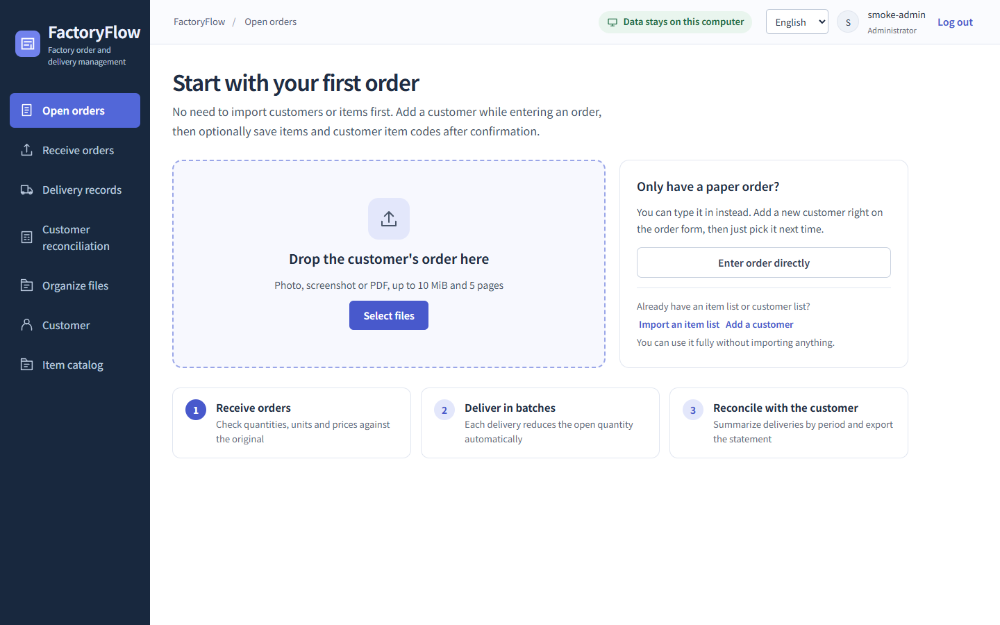
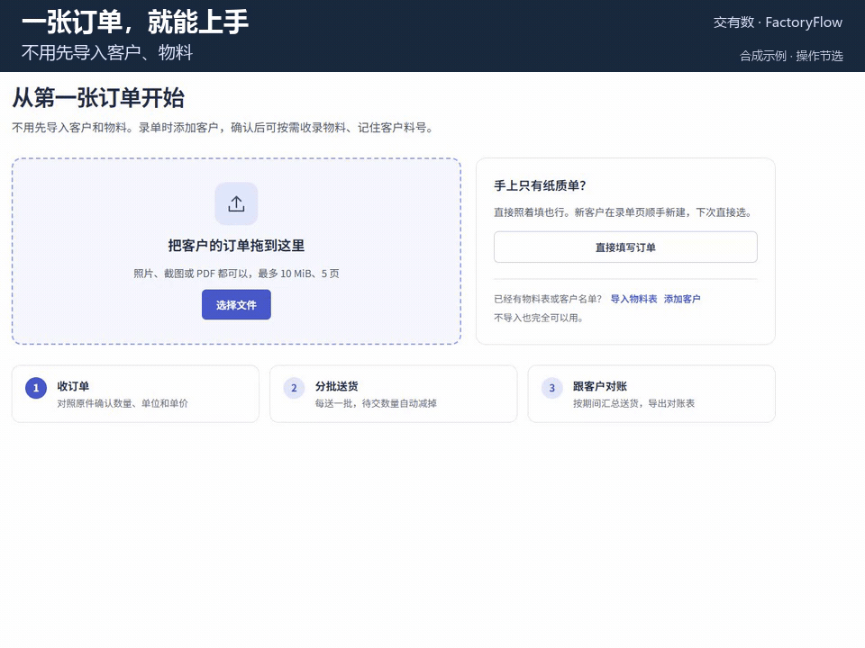
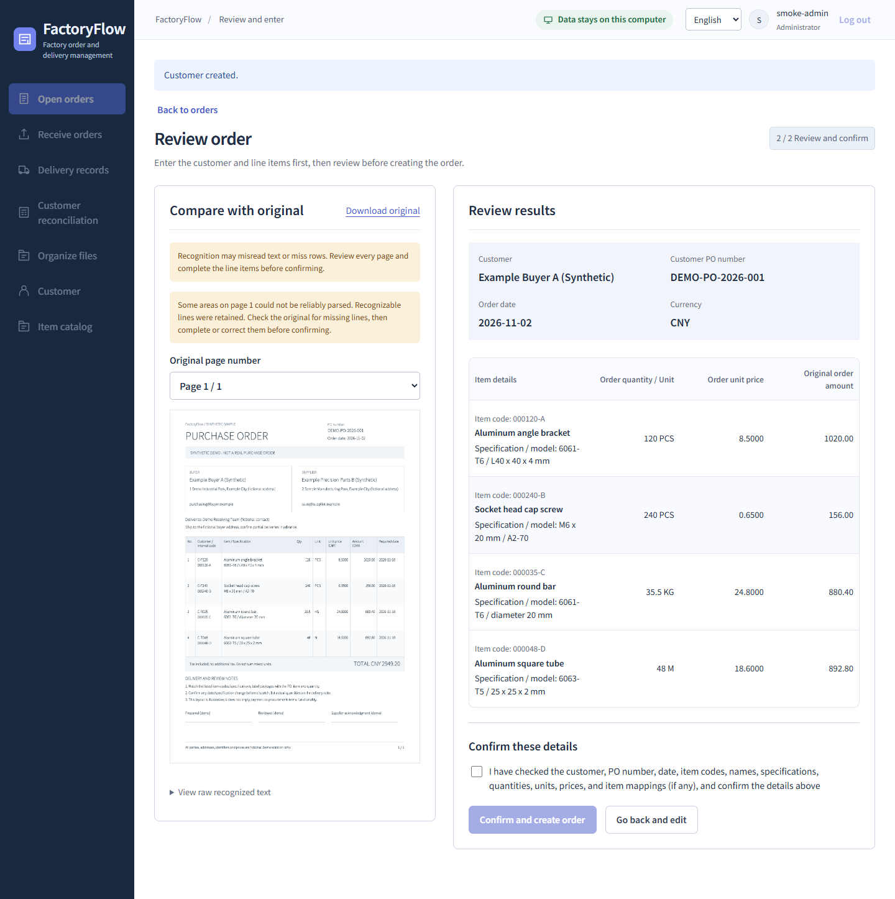
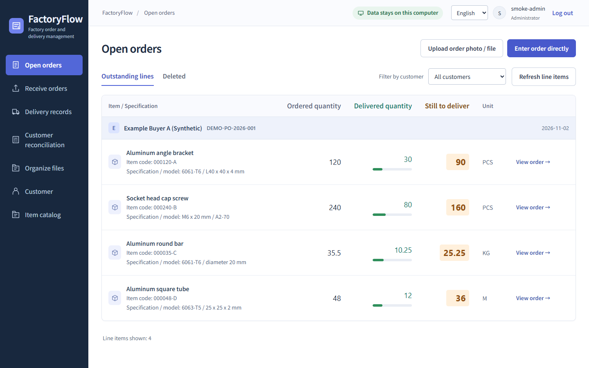

<p align="center"><a href="README.md">简体中文</a> · <strong>English</strong></p>

<p align="center">
  
</p>

<h1 align="center">FactoryFlow</h1>

<p align="center">
  <strong>Orders, deliveries and customer reconciliation for small factories.</strong><br>
  Built with direct involvement from frontline factory staff. An earlier version is in daily factory use.<br>
  Start with your first order, no setup imports. Your data and OCR stay on your own computer.
</p>

<p align="center">
  <a href="https://github.com/Doublzzz/FactoryFlow/releases/tag/v0.1.0-preview.1"></a>
  
  
  <a href="LICENSE"></a>
</p>

<p align="center">
  <a href="#download-and-try">Download</a> · <a href="#how-an-order-moves">How it works</a>
</p>



## Why it works this way

**No catalog required. Start with the first order.** Many small factories have no tidy customer list or item catalog. Photograph an order or type in a paper one; create the customer while you enter it. When the same items keep coming back, add them to the item catalog. You can still import an existing item list first.

**Your data stays on this computer.** The offline package bundles its own database and local OCR models. Order originals, deliveries and statements are stored locally. Nothing goes through a cloud service, no online account is needed, and it keeps working without internet.

**People confirm each step, and the numbers add up.** Recognition only proposes candidates; an order exists only after someone checks it against the original. PCS, KG and M stay separate, quantities and money use exact decimals, and revising an order saves a new version while keeping the old one and its evidence.

## Details from a real small factory

FactoryFlow was built with direct involvement from frontline factory staff, and an earlier version is already in daily use at a small factory. It focuses on concrete questions: What is still owed on this order? How much of what was delivered has the customer accepted? What belongs on this month's statement, and what still needs following up?

- **One order, several deliveries, a clear balance.** Record each batch against its order lines and print a delivery note. If a delivery was entered incorrectly, voiding it restores the outstanding quantities and keeps the original record.
- **Pieces, weight and length each keep their own count.** One order can mix PCS, KG and M. Outstanding quantities are calculated per line, without adding incompatible units into one total.
- **The customer's item code connects to yours.** One item can have different codes for different customers, with leading zeros preserved in text codes. Enter an order first and link it to the catalog later; its original names, specifications and item codes remain intact.
- **Month-end statements follow the customer's format.** Upload a customer Excel template, map its fields and check the preview. Statement lines can also record the customer's external document number so both sides can find the same delivery.
- **Partial acceptance leaves something to follow up.** Customer acceptance, pending review and current-period settlement are separate records. Accepted quantities can be settled across periods, with carry-forwards explicitly arranged by a person. Neither acceptance nor a finalized statement means payment has arrived.
- **Later checks can go back to the original and the right version.** Order changes save a new revision, finalized settlement evidence is retained, and delivery records, customer feedback and related files remain available for reference.

## Download and try

For Windows 10/11 x64, download `FactoryFlow-Windows-x64-v0.1.0-preview.1.zip` (about 174 MB) from the [v0.1.0-preview.1 release](https://github.com/Doublzzz/FactoryFlow/releases/tag/v0.1.0-preview.1).

1. Extract the whole ZIP, run `安装.cmd`, and follow the prompts to review the third-party component terms and install.
2. Open the FactoryFlow desktop shortcut. On first launch, set your factory name and local account.
3. Try entering an order, a partial delivery and a statement with the [synthetic purchase orders](samples/purchase-orders/README.en.md).

You do not need to install Python, a database or Node.js. The [offline guide](docs/FACTORY-OFFLINE-GUIDE.txt) covers installation, backups and troubleshooting; it and the installer prompts are currently in Chinese. Application source, third-party source materials and `SHA256SUMS.txt` are on the same release page.

## How an order moves

**1. Take the order.** Upload a photo, screenshot or PDF and check the extracted lines next to the original, or enter the order by hand. Here is the whole flow in the Chinese UI:



<sub>Chinese UI; synthetic demo at 0.5× speed, with recognition waiting and parts of manual review omitted. <a href="docs/README-SCREENSHOTS.md">Capture notes</a></sub>



<sub>This shows the result after manual review. Recognition only proposes candidates, and table parsing is still unreliable, so lines need correcting or adding against the original. <a href="docs/README-SCREENSHOTS.md">Raw recognition results</a></sub>

**2. Deliver in batches.** Record how much each delivery covers per order line, and the outstanding quantity goes down. Voiding a delivery restores its quantities and keeps the record.



<sub>One synthetic order: 30 of 120 PCS delivered leaves 90 PCS; 10.25 of 35.5 KG delivered leaves 25.25 KG.</sub>

**3. Reconcile with the customer.** Gather a period's deliveries into a draft statement, record what was sent and how the customer replied, and keep accepted, pending-review and deferred quantities apart.

**4. Finalize the period.** Fix this period's quantities and amounts, explicitly carry eligible balances forward, and keep earlier evidence.

**5. Export and file.** Export statements in the built-in format or the customer's own Excel template, and keep order originals, delivery copies and statements filed together.

## Current limits

- This is a newly packaged **Windows developer preview**. Installation on a clean Windows machine, native Excel pagination, physical printing and compatibility with more document layouts are still being verified; see the [verification record](docs/VERIFICATION.md).
- Single computer only, with no multi-user access over a local network.
- During the preview, data is not guaranteed to carry over to the next version. Do not keep your only copy of real business data in the preview, and back up regularly.
- **CNY only.** Customer acceptance and finalized statements do not mean payment was received, and statements and delivery notes are not tax invoices. No inventory, payments, multiple currencies or foreign tax.
- The UI supports Simplified Chinese and English, and so do the built-in statement Excel and delivery printing. Customer names, item codes and source text stay as written, customer templates keep their wording, and archived delivery copies currently use the Chinese layout.
- Backups and exports contain business information; keep them private. See the [distribution notes](docs/DISTRIBUTION.md) for build inputs and third-party materials.

## Develop from source

You need Windows, Node.js 24 (see `package.json` for the exact range), uv, Python 3.14 and a separate PostgreSQL instance; installing development dependencies the first time needs internet access. Follow the [local operations guide](docs/LOCAL-OPERATIONS.md) for dependencies, configuration, explicit migrations and the first local account. Startup never migrates or resets data on its own.

```powershell
npm run typecheck
npm run contracts:check
npm run build
```

Further reading: [business rules](docs/PRODUCT-SPEC.md) · [architecture](docs/ARCHITECTURE.md) · [glossary](docs/GLOSSARY.zh-en.md) · [privacy and release scope](docs/PRIVACY.md)

## Development and feedback

AI helped write the code, documentation and tests; the maintainer decides requirements, scope and releases. Business writes in the product are always confirmed by the person using it.

Feedback is welcome in [GitHub Issues](https://github.com/Doublzzz/FactoryFlow/issues/new/choose): Which step is hard to follow? Which units or document layouts are hard to check? Reproduce problems with synthetic data, and do not upload real customer documents, prices, credentials, databases or full logs. Report security vulnerabilities privately using the [security policy](SECURITY.md).

## License

[MIT](LICENSE): commercial use and closed-source redistribution are allowed with the copyright and license notices retained. Fonts and dependencies keep their own licenses; see [third-party materials](THIRD-PARTY-NOTICES.md).
