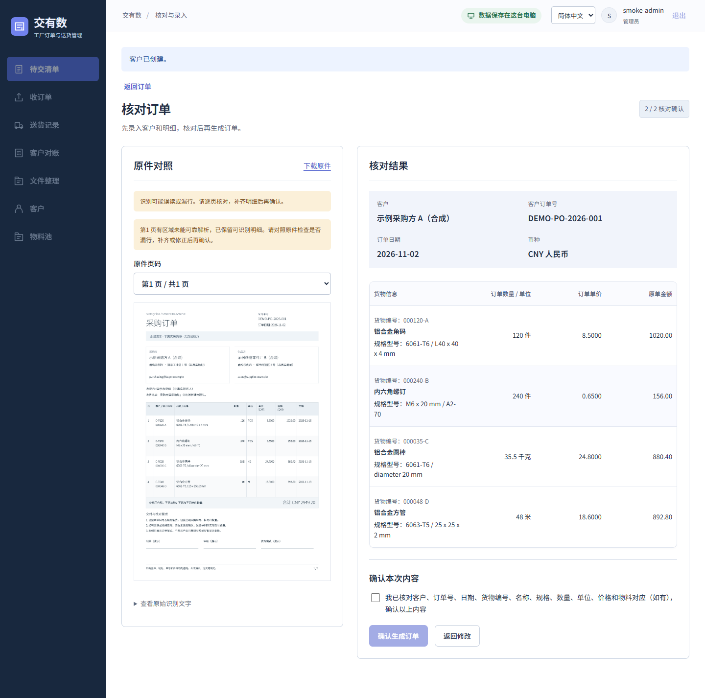
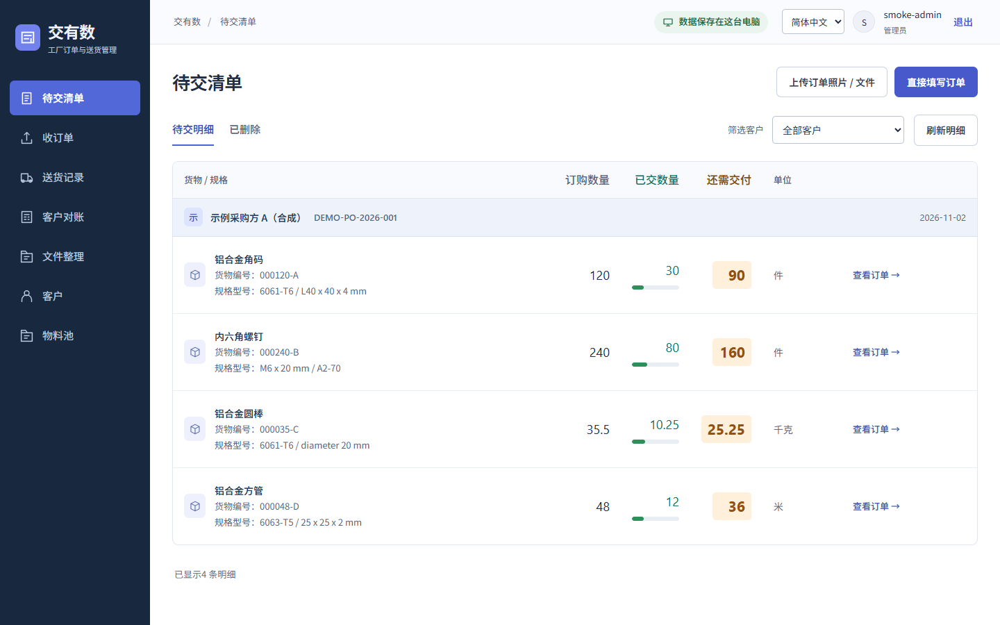

<p align="center"><strong>简体中文</strong> · <a href="README.en.md">English</a></p>

<p align="center">
  
</p>

<h1 align="center">交有数 FactoryFlow</h1>

<p align="center">
  <strong>给小工厂老板和办公室人员的订单、送货与对账工具。</strong><br>
  工厂一线业务人员直接参与制作，早期版本已在工厂日常使用。<br>
  不用先导入资料，从第一张订单开始用；数据和识别都在你自己的电脑上。
</p>

<p align="center">
  <a href="https://github.com/Doublzzz/FactoryFlow/releases/tag/v0.1.0-preview.2"></a>
  
  
  <a href="https://github.com/Doublzzz/FactoryFlow/actions/workflows/verify.yml"></a>
  <a href="LICENSE"></a>
</p>

<p align="center">
  <a href="#下载试用">下载试用</a> · <a href="#一张订单怎么走完">看看怎么用</a> · <a href="#后续模块与定制需求">定制需求</a>
</p>


<p align="center"><sub>合成演示，0.5 倍速节选，省略了识别等待和部分逐项核对。<a href="docs/README-SCREENSHOTS.md">演示说明</a></sub></p>

## 谁适合用

主要面向小型生产工厂的老板，以及负责跟单、安排送货和月末对账的办公室人员：每天要记清客户订了什么、已经交了多少、还欠多少，以及哪些已经获得客户认可、安排在本期结算。

如果贸易公司只需要管理客户订单、分批交货和对账，也可以试用这套流程。preview.2增加可选成品库存；供应商采购、原材料、生产/BOM 和成本毛利管理，目前还不覆盖。

## 为什么做成这样

**不用先建档，从第一张订单开始。** 很多小厂手上没有整理好的客户名单和物料表。拿到订单拍张照、或者照着纸质单填，客户在录单时顺手新建；同样的货反复出现了，再把它收录进物料池。已经有物料表的，也可以先导入。

**数据只在这台电脑上。** 离线安装包自带数据库和本地识别模型。订单原件、送货记录、对账文件都存在本机，不经过云端，不用注册在线账号，断网也能用。

**每一步由人确认，数量对得上。** 识别只给候选，人对照原件核对后才生成订单。件、千克、米分开算，数量和金额用精确小数；改订单会另存新版本，旧版本和凭证都留着。

## 这些细节来自真实的小厂

工厂一线业务人员直接参与了交有数的制作，早期版本已经在工厂日常使用。产品围绕具体业务问题展开：这张单还欠多少？送出去的货，客户认了多少？哪些放进本月对账，哪些还要跟进？

- **一张订单分几次送，剩多少要看得清。** 每批按订单行登记数量、打印送货单；录错后作废这次送货，未交数量随之恢复，原记录仍能查到。
- **件数、重量和长度，各有各的账。** 同一张单可以有件、千克、米，未交数量按行计算，不把不同单位硬加成一个总数。
- **客户的料号，和自家的料号对得上。** 同一物料可对应不同客户的不同料号，文本编号的前导零保留。先录单、之后补入物料池，也保留原订单上的名称、规格和料号。
- **月底按客户的表格交账。** 客户 Excel 模板可上传、对应字段并核对预览；对账行还能填客户的外部单号，方便双方找到同一笔送货。
- **只认可了一部分，剩下的还要继续跟。** 客户认可、待核对、本期结算分别记录；已认可的数量可以分期结算，需要转期的余量由人明确安排。客户认可和正式结算都不代表钱已到账。
- **回头核对时，找得到原件和当时的版本。** 订单修改会另存版本，已固定的结算凭证保留；送货记录、客户反馈和相关文件都有据可查。

## 下载试用

Windows 10/11 x64 开发者预览：[v0.1.0-preview.2](https://github.com/Doublzzz/FactoryFlow/releases/tag/v0.1.0-preview.2)。下载 `FactoryFlow-Windows-x64-v0.1.0-preview.2.zip`（约 174 MB），包含 CNY/USD、英文安装流程和可选成品库存。

1. 完整解压 ZIP，双击 `安装.cmd`；英文用户运行 `Install.cmd`。按提示阅读第三方组件条件并完成安装。
2. 打开桌面的 FactoryFlow 入口，首次启动时设置工厂名称和本地账号。
3. 用仓库里的[合成采购单](samples/purchase-orders/README.md)试一遍录单、分批送货和对账。

无需在线账号，也不用另装 Python、数据库或 Node.js。安装、备份和故障处理见[中文使用说明](docs/FACTORY-OFFLINE-GUIDE.txt)或[English guide](docs/FACTORY-OFFLINE-GUIDE-en.txt)。同版应用源码、第三方源码材料和 `SHA256SUMS.txt` 在版本页面。

请使用新的数据目录试用，保留现有安装及备份；本次不提供业务数据库的原地升级。旧 [preview.1](https://github.com/Doublzzz/FactoryFlow/releases/tag/v0.1.0-preview.1) 继续保留。检查结果与边界见[当前状态](docs/STATUS.md)和[验证记录](docs/VERIFICATION.md)。

## 一张订单怎么走完

**1. 收单。** 上传订单照片、截图或 PDF，左边看原件、右边核对识别出的明细；也可以直接手填。



<sub>上图是人工核对后的结果。识别只提出候选，表格解析还不稳定，需要对照原件校正或补录。<a href="docs/README-SCREENSHOTS.md">原始识别结果</a></sub>

**2. 分批送货。** 按订单行登记每次送了多少，待交数量自动减掉；作废一次送货会退回原数量，记录保留。



<sub>同一张合成订单：120 件交了 30 件，剩 90 件；35.5 千克交了 10.25 千克，剩 25.25 千克。</sub>

**3. 跟客户对账。** 按期间把送货明细汇成对账草稿，记录发给客户的依据和客户反馈，区分已认可、待核对和暂缓的数量。

**4. 固定本期结算。** 确认这一期的数量与金额，符合条件的余额显式转到下期，早期凭证都保留。

**5. 导出和归档。** 用内置格式或客户自己的 Excel 模板导出对账单，订单原件、送货副本和对账文件统一整理归档。

## preview.2 的成品库存与币种

**成品库存按需启用。** 不用库存也能完成订单、送货和对账；需要时按成品开账，记录入库和实盘。送货可同步扣减，也可明确跳过、留待核对；账面不足时须确认后才允许负余额。作废送货按原库存流水冲回，旧送货不追扣，未开账也不等于零库存。本轮不含原材料、采购、生产/BOM、批次多仓或成本核算。

**CNY 和 USD 分别记账。** 每张订单、每张对账单保持一种币种，订单确认后币种不可更改；同一客户同一期间的两种币种分别对账，不相加、不换汇。界面语言与币种独立，不新增收付款、发票或海外税务规则。

## 当前限制

- 当前版本为 **Windows 开发者预览**，安装与业务流程的检查记录见[验证记录](docs/VERIFICATION.md)。
- 只支持单机使用，不提供局域网多人访问。
- 预览阶段，升级到新版本时能否直接沿用数据暂不保证。不要把唯一一份真实业务数据放在预览版里，记得定期备份。
- preview.2支持 **CNY / USD**，不含汇率换算和收付款。客户认可和正式结算不代表收到付款，对账单和送货单不是税务发票，不提供海外税务合规。
- 界面默认简体中文，可切换 English；内置对账 Excel、送货打印和新归档支持英文，生成时固定语言。客户名称、料号、原件、客户模板及自定义版式文字保持原样；旧导出和归档不因切换语言而改变。
- 备份和导出文件里有业务资料，需要自己妥善保管。构建输入与第三方材料见[分发说明](docs/DISTRIBUTION.md)。

## 后续模块与定制需求

成品库存已进入 preview.2。如果你需要其他业务流程，或希望按自己的工厂流程定制功能，欢迎[联系我讨论](https://github.com/Doublzzz/FactoryFlow/issues/new?template=feature_request.yml)。可以先说说谁来用、现在怎么处理、希望解决什么问题，再一起确认范围。

目前通过 GitHub 功能建议接收需求。公开留言只需概述场景，不要附真实客户单据或敏感业务资料。

## 从源码开发

需要 Windows、Node.js 24（准确范围见 `package.json`）、uv、Python 3.14 和独立的 PostgreSQL，首次安装开发依赖需要联网。按[本地运行说明](docs/LOCAL-OPERATIONS.md)准备依赖、配置、显式迁移和首个本地账号后再启动；启动本身不会自动迁移或重置数据。

```powershell
npm run typecheck
npm run contracts:check
npm run build
```

更多背景：[业务规则](docs/PRODUCT-SPEC.md) · [架构](docs/ARCHITECTURE.md) · [术语表](docs/GLOSSARY.zh-en.md) · [隐私与发布范围](docs/PRIVACY.md)

## 开发与反馈

AI 协助编写了代码、文档和测试；需求、范围和发布由维护者决定。产品里的业务写入始终由使用者确认。

欢迎在 [GitHub Issues](https://github.com/Doublzzz/FactoryFlow/issues/new/choose) 反馈：哪一步不好懂？哪种单位或单据版式难核对？请用合成数据复现，不要上传真实客户原件、价格、账号、数据库或完整日志。安全漏洞请按[安全反馈说明](SECURITY.md)私下报告。

## 许可

[MIT](LICENSE)：允许商用和闭源再分发，须保留版权与许可声明。字体及依赖遵循各自许可，见[第三方材料清单](THIRD-PARTY-NOTICES.md)。
